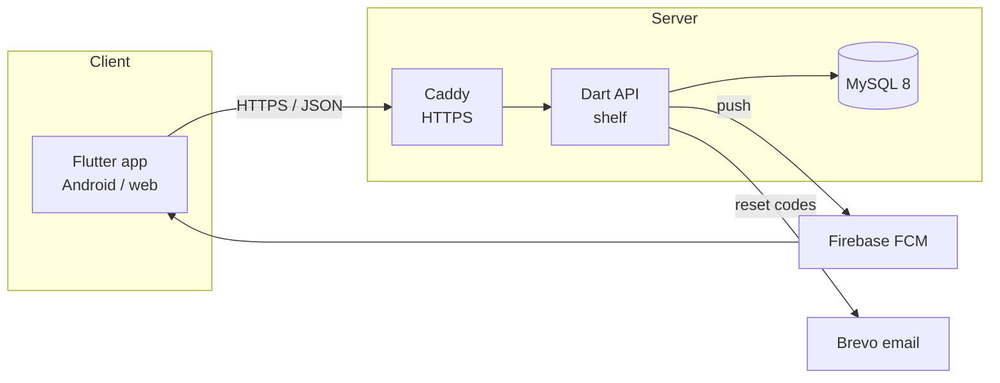

# DSA Academy Application

[](https://github.com/Bahalanaz/DSA-Academy-Application/actions/workflows/ci.yml)

**A real product in production use, not a tutorial or demo.** A full-stack
management app for a youth basketball academy in the UAE, built with
**Flutter** and a **Dart** REST API on **MySQL**. Families register players,
follow training and tournaments, pay fees and order kit; coaches run the
whole academy from the same app.

## Project status and my role

- **Live since October 2026.** The academy's families and coaches use it
  every day: an Android app plus an installable web version for iPhone and
  laptops.
- **Built and maintained by me, end to end.** I gathered the requirements
  with the academy and did the design, the Flutter app, the API, the
  database, hosting and deployment, and I support the people using it.
- **In active development.** New features ship regularly as versioned
  releases (currently 1.0.25), driven by feedback from the academy and its
  families.
- **Real production work:** changing a live database without losing data,
  keeping apps already installed on families' phones working through server
  updates, recovering from a server outage, and handling real money (fees,
  refunds, credit).

This repository is a public copy of the code, shared with the academy's
permission. Server addresses, keys and every piece of real data have been
removed, and the database seeds contain only made-up people.

## At a glance

| | |
|---|---|
| **App** | Flutter (Android + web/PWA) · 34 screens · ~34,000 lines of Dart |
| **Backend** | Dart ([shelf](https://pub.dev/packages/shelf)) REST API · 90+ endpoints · ~10,000 lines |
| **Database** | MySQL 8 · 32 tables · versioned SQL migrations |
| **Integrations** | Firebase Cloud Messaging (push), Brevo (email) |
| **Quality** | 120+ automated tests · GitHub Actions CI · Docker |
| **Hosting (production)** | Linux VM, Caddy for HTTPS, systemd |

## Features

**For families**
- Register children; their age category comes from their birth year
- Pick a jersey number from a 0–99 grid (parents see a number is taken, never who has it)
- Training schedule, attendance, awards and tournament invitations (accept, or decline with a reason)
- Tournament standings, game results and the tournament each game belongs to
- Monthly training fees, tournament fees and kit orders, tracked from approval to "received"
- Announcements, direct messages and birthday greetings, with push notifications

**For the academy**
- Account and player validation queues; parent and player management
- Trainings, sessions and attendance; tournament rosters with warnings for jersey clashes and over-age players
- Billing that closes each month automatically: coach fee plus a per-session rate, admin overrides, credit carried forward, refunds and waivers
- Kit catalogue, order approval and "Others" bills with a description

## Architecture



```
dsa_app/            Flutter app
  lib/core/         API client, config, theme, shared widgets
  lib/features/     admin/, parent/, auth/ screens and models
  database/         schema.sql, migrations/, grants, demo seed data
  test/             unit and widget tests
dsa_server/         Dart API server
  bin/server.dart   entry point, routing, auth middleware
  lib/              one file per area: billing, payments, sessions, tournaments…
  test/             rule tests and API tests against a real MySQL
docker-compose.yml  MySQL + server for local development
```

## Engineering notes

- **Money is append-only.** Every change to what's been paid writes a row to
  a transactions table in the same database transaction, and the app's
  database user may only `SELECT`/`INSERT` there: history can be added to,
  never rewritten. Amounts are compared in whole fils (1/100 AED) to avoid
  floating-point errors.
- **Concurrency.** Paying, refunding and closing a month take a MySQL named
  lock, so two operations can't act on a stale view of the same bill. Jersey
  numbers have their own lock, so two families can't take the last free
  number at the same moment.
- **A hang fixed below the app.** The MySQL driver's pool leaked connections
  on errors and then spun forever once full, freezing the server. It is
  wrapped with a semaphore and safe transaction handling (`dsa_server/lib/db.dart`).
- **Privacy by design.** Families only ever see their own children. Account
  deletion anonymises personal data while keeping financial records.
- **Least privilege.** The server connects as its own MySQL user with
  per-table grants (`dsa_app/database/app_user_grants.sql`), never root.
  Secrets live only in environment files that are never committed.
- **Backward-compatible releases.** The server only ever adds fields, so
  families on an older app version keep working after a server update.

## Run it locally

You need [Docker](https://www.docker.com/) for the backend and
[Flutter](https://docs.flutter.dev/get-started/install) for the app.

**1. Backend (MySQL + API):**

```bash
cp docker.env.example .env        # choose two passwords
docker compose up -d --build
curl http://localhost:8080/health
```

The database is built from `dsa_app/database/schema.sql` on first start. It
includes one demo admin: **`admin` / `admin123`** (local use only).

To load the made-up families, players and bills used for testing:

```bash
docker compose exec -T db mysql -uroot -p"<root password>" dsa_db < dsa_app/database/seed_test_data.sql
```

This replaces everything with test data: the admin becomes `coach`, the
parents are `rlopez`, `mtan`, `jcruz` and others, all with the password
`admin123`.

**2. App:**

```bash
cd dsa_app
flutter pub get
flutter run -d chrome                                                 # web, talks to localhost:8080
flutter run --dart-define=API_BASE_URL=http://10.0.2.2:8080           # Android emulator
```

Push notifications stay off until you add your own Firebase project (see
[dsa_app/README.md](dsa_app/README.md)); everything else works without it.

## Tests

```bash
cd dsa_server && dart test     # API tests need a MySQL: see dsa_server/README.md
cd dsa_app && flutter test
```

CI ([ci.yml](.github/workflows/ci.yml)) runs formatting, analysis and the
tests for both parts, starts the Docker stack and signs in to it, and builds
the server, an APK and the web app on every push.

## License

The code belongs to the academy and is shown here, with their permission,
as part of my portfolio. All rights reserved: please ask
before reusing the code.
